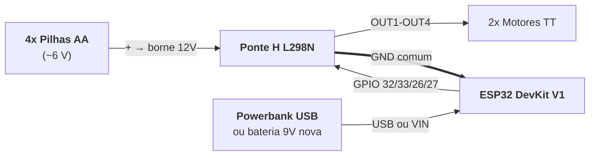

# 📡 Firmware ESP32 (Controle Wi-Fi) e Diagnóstico de Bancada

> **Referência:** Montagem e testes de integração do protótipo com **ESP32 DevKit V1 + Ponte H L298N**  
> **Firmware:** [`firmware/carrinho_esp32/carrinho_esp32.ino`](../firmware/carrinho_esp32/carrinho_esp32.ino)

Este documento registra a configuração **realmente montada e testada** do carrinho com ESP32, os problemas encontrados durante a integração e as soluções adotadas. Ele substitui, para a versão ESP32, a pinagem planejada nos documentos anteriores.

---

## 1. Pinagem Final (ESP32 ↔ L298N)

| Ponte H L298N | ESP32 | Função |
| :---: | :---: | :--- |
| `IN1` | `GPIO 32` | Motor esquerdo (frente) |
| `IN2` | `GPIO 33` | Motor esquerdo (ré) |
| `IN3` | `GPIO 26` | Motor direito (ré) |
| `IN4` | `GPIO 27` | Motor direito (frente) |
| `ENA` | Jumper no `5V` da própria ponte H | Motor esquerdo sempre habilitado (velocidade máxima) |
| `ENB` | Jumper no `5V` da própria ponte H | Motor direito sempre habilitado (velocidade máxima) |
| `GND` (borne do meio) | `GND` | **Terra comum obrigatório** |
| `OUT1` / `OUT2` | — | Motor esquerdo |
| `OUT3` / `OUT4` | — | Motor direito |

> [!WARNING]
> **Pinos que não devem ser usados para a ponte H:**
> - `GPIO 34`, `35`, `36` e `39` são **somente entrada** no ESP32 e não conseguem acionar `IN1`–`IN4`.
> - `GPIO 25` foi abandonado durante os testes, depois de apresentar comportamento instável (motor girando sozinho). A causa mais provável era mau contato no jumper, mas o pino foi substituído para eliminar a dúvida.

Se uma roda girar no sentido errado, ajuste `INVERTE_ESQ` / `INVERTE_DIR` no firmware ou inverta os dois fios do motor nos bornes `OUT` correspondentes. Use os botões **"Só Motor Esq"** e **"Só Motor Dir"** da página para conferir: cada roda deve girar **para frente**.

---

## 2. Arquitetura de Alimentação Adotada

As medições de bancada (seção 4) mostraram que **o ESP32 não pode compartilhar a fonte dos motores**. A topologia final separa as duas linhas e mantém apenas o GND em comum:

| Linha | Fonte | Ligação |
| :--- | :--- | :--- |
| **Potência (motores)** | 4x pilhas AA | Positivo no borne `12V`, negativo no `GND` da ponte H |
| **Lógica (ESP32)** | Powerbank no USB **(recomendado)** ou bateria 9V alcalina nova | USB, ou positivo no `VIN` e negativo no `GND` do ESP32 |
| **Referência** | — | Jumper do `GND` da ponte H até um `GND` do ESP32 |
| **Proibido** | — | Fio do `5V` da ponte H até o `VIN` do ESP32 (remover) |
| **Proibido** | — | Bateria 9V e pilhas em paralelo no mesmo borne `12V` |

> [!NOTE]
> **Solução definitiva recomendada:** pack **2x 18650 (7,4 V)** no borne `12V`. Com mais de 7 V na entrada, o regulador 78M05 da ponte H entrega 5 V estáveis, e os motores recebem mais tensão (a L298N perde cerca de 2 V internamente).

---

## 3. Firmware: Como o Controle Funciona

O ESP32 cria a própria rede Wi-Fi e serve a página de controle. Não é preciso app nem internet.

| Item | Valor |
| :--- | :--- |
| Rede Wi-Fi | `Carrinho_MakerLab` |
| Senha | `12345678` |
| Endereço da página | `http://192.168.4.1` |
| Canal Wi-Fi | `6` (constante `CANAL`; trocar para 1 ou 11 se o laboratório estiver congestionado) |
| Potência de transmissão | `15 dBm` (alcance suficiente para uma sala, com pico de corrente menor) |
| Bibliotecas | Apenas as do core ESP32 (`WiFi`, `WebServer`, `Ticker`). Nada para instalar. |
| Compatibilidade testada | Core ESP32 para Arduino **2.0.9** e **3.0.7** (compila sem erros nem warnings) |

### 3.1. Protocolo de comandos

| Comando (`/cmd?c=`) | Ação |
| :---: | :--- |
| `F` | Frente |
| `B` | Ré |
| `L` | Giro à esquerda (no próprio eixo) |
| `R` | Giro à direita (no próprio eixo) |
| `E` | Teste: só o motor esquerdo, para frente |
| `D` | Teste: só o motor direito, para frente |
| `S` (ou qualquer outro) | Parar |

### 3.2. Mecanismos de segurança

1. **Reenvio contínuo:** enquanto um botão está pressionado, a página reenvia o comando a cada ~100 ms. Ao soltar, envia `S`.
2. **Failsafe no ESP32 (700 ms):** se o ESP32 ficar 700 ms sem receber comando (dedo solto, Wi-Fi caiu, página fechada), ele para os motores sozinho. A checagem roda em um timer do sistema (`Ticker`), independente do `loop()`.
3. **Um pedido por vez, em ordem:** a página nunca dispara pedidos em paralelo, então um `S` antigo não pode chegar depois de um `F` novo (e vice-versa).
4. **Pedido perdido é reenviado:** se a resposta não chegar em 450 ms, a página desiste e reenvia antes de o failsafe agir, evitando trancos com Wi-Fi ruim.
5. **Pointer Events com captura:** o toque é tratado com `pointerdown` / `pointerup` / `pointercancel`. Arrastar o dedo para fora do botão, abrir menu ou trocar de aba também param o carro. Suporta dois dedos (vale o último botão apertado).

### 3.3. Diagnóstico embutido na página

O topo da página mostra **"Conectado · ESP32 ligado há X s"**, o número de reinícios vistos e o motivo do último reset (`ligou_normal`, `QUEDA_DE_TENSAO`, `TRAVOU(watchdog)` etc.). **Se o tempo ligado voltar para zero, o ESP32 reiniciou, o que quase sempre indica alimentação insuficiente.** O mesmo motivo é impresso no Monitor Serial a 115200 baud.

### 3.4. Testes realizados

A página foi testada em navegador móvel emulado (Pixel 7, Playwright), contra um servidor que imita o ESP32, inclusive o failsafe. Cenários testados com Wi-Fi bom, Wi-Fi lento (0–150 ms) e Wi-Fi perdendo 10% dos pedidos:

| Cenário | Resultado |
| :--- | :--- |
| Segurar ▲ por 2 s | Anda continuamente, **sem paradas do failsafe** |
| Soltar o botão | Para em 10–480 ms |
| Toque rápido | Termina parado |
| Dois dedos (▲ + ◄, solta ◄) | `L` → `F` → `S` |
| 30 toques aleatórios seguidos | Termina parado |
| Arrastar o dedo para fora do botão | Termina parado |
| Wi-Fi cai com o botão pressionado | ESP32 para sozinho; página mostra "SEM CONEXÃO" |

> O hardware real (motores, ponte H, ESP32) não foi coberto por esses testes automatizados.

---

## 4. Registro de Problemas e Diagnóstico de Bancada

| # | Sintoma | Causa identificada | Solução |
| :---: | :--- | :--- | :--- |
| 1 | Só com bateria 9V, o ESP32 fica piscando (reinicia em loop) | A 9V não fornece a corrente de pico do Wi-Fi (~350–500 mA). A tensão cai e o *brownout detector* reinicia o chip. | Separar as fontes (seção 2). O brownout foi desativado como paliativo. |
| 2 | Uma roda gira sozinha e não para | Mau contato em um jumper de `IN3`/`IN4`. O teste de trocar os pares `IN1/IN2` ↔ `IN3/IN4` fez o defeito mudar de roda, o que provou que **o motor estava bom**. | Reencaixar ou trocar os jumpers; motor direito movido para `GPIO 26` / `27`. |
| 3 | Motor direito só gira para frente | Jumper do `GPIO 27` desconectado | Reconectar |
| 4 | Toca ▲ uma vez e o carro anda para sempre; botões param de responder | **Bug de software:** cada toque gerava 4 requisições em paralelo (`touchstart`, `touchend` e os `mousedown`/`mouseup` emulados pelo navegador). Quando um `F` chegava depois do `S`, o carro não parava. Não havia failsafe no ESP32. | Firmware novo (seção 3) |
| 5 | Funciona um pouco, depois o Wi-Fi cai e a página não carrega | **Alimentação insuficiente no ESP32** (medições abaixo), agravada pelo brownout desativado: em vez de reiniciar, o chip continua rodando sem tensão suficiente. | Separar as fontes (seção 2) |
| 6 | Página não carrega mesmo conectado na rede do carrinho | O Android detecta "rede sem internet" e manda o tráfego pelos dados móveis | Desligar os dados móveis e escolher "manter conexão" |

### 4.1. Medições de bancada

| Ponto medido | Condição | Valor | Referência | Situação |
| :--- | :--- | :---: | :--- | :---: |
| Bateria 9V | Sem carga | **7,27 V** | Nova: 9,3–9,6 V | ⚠️ Quase descarregada |
| Pack 4x AA | Sem carga | **5,73 V** | Nova: ~6,2 V (1,43 V por pilha) | ✅ Utilizável para os motores |
| Pino `3V3` do ESP32 | Motores girando (▲ pressionado) | **2,90 V** | Mínimo: 3,0 V (ideal 3,2–3,3 V) | ❌ **Abaixo do mínimo** |

**Conclusão:** a medida de 2,90 V no `3V3` com os motores girando confirma que a queda de Wi-Fi é causada por alimentação. Com 4x AA (~5,7 V), o regulador 78M05 da ponte H entrega apenas ~3,7 V, e o regulador do ESP32 tira mais ~1 V, deixando o chip abaixo do mínimo. A bateria 9V, já em 7,27 V, também não segura os picos de corrente do Wi-Fi. Uma bateria 9V alimentando só o ESP32 com Wi-Fi dura em torno de 2 a 4 horas.

### 4.2. Procedimento de verificação

1. Separar as fontes conforme a seção 2.
2. Medir o pino `3V3` do ESP32 em relação ao `GND`, com ▲ pressionado. O resultado deve ser **3,2–3,3 V**.
3. Opcional: medir o `VIN` nas mesmas condições. Deve ficar **acima de 4,5 V**.
4. Se o `3V3` cair só com os motores girando, ainda existe ligação entre a alimentação dos motores e a do ESP32.
5. Com o `3V3` estável, mudar `DESLIGA_BROWNOUT` para `false` no firmware e regravar.
6. Opcional: capacitor eletrolítico de 470–1000 µF entre `VIN` e `GND` do ESP32 (faixa "−" no `GND`) e capacitores cerâmicos de 100 nF nos terminais dos motores.
